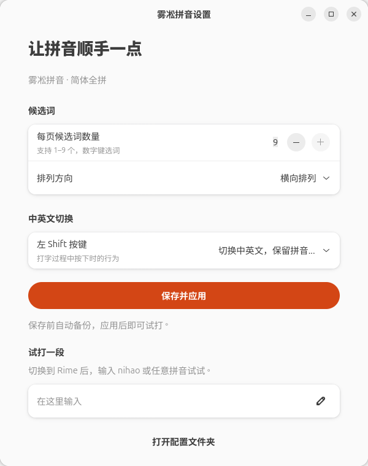
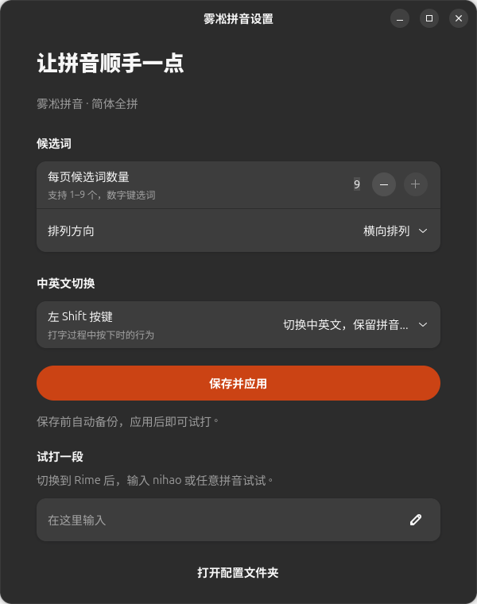

<div align="center">

# 雾凇拼音设置 ✨

### 救命，改个候选词数量，终于不用翻 YAML 了。

**给 IBus-Rime + 雾凇拼音补一个顺手的小面板。**

改数量 · 换横竖 · 调 Shift · 点一下就生效

[](LICENSE)
[](https://github.com/seldoms/rime-settings/actions/workflows/tests.yml)


[🪄 让 Agent 帮我装](INSTALL_WITH_AGENT.md) · [🚀 自己动手](#-自己装也很快) · [📸 看图说话](#-长这样原生窗口看着就舒服)

</div>

---

## 🪄 懒人先看：把这段扔给 Agent

想用，又不想折腾依赖和输入法配置？懂你。**复制，粘贴，让它干活。**

```text
请帮我安装并验证 https://github.com/seldoms/rime-settings 。
先读取仓库里的 INSTALL_WITH_AGENT.md，按其中流程实际完成安装，
不要只给我命令清单。我授权安装必要的官方依赖、备份和非破坏性配置修改。
请识别真实桌面用户和当前输入法，保留词库与个人设置，遵守沙箱和审批规则。
若已在使用 Fcitx5，请先告知兼容范围，再确认是否迁移；不要直接替换框架。
最后打开设置窗口，验证候选词保存与部署，并还原测试产生的临时改动。
```

👉 **完整提示词：[INSTALL_WITH_AGENT.md](INSTALL_WITH_AGENT.md)**。从环境识别到出词验证都写好了，方便 Agent 自己推进。

需要 Agent 能访问你的 Linux 桌面和终端。纯网页聊天窗口无法代你安装本机应用。

## 📸 长这样，原生窗口看着就舒服



<details>
<summary>🌙 深色模式也安排了，点击展开</summary>



</details>

截图来自实际 GTK 窗口。**没有网页套壳，安装后从应用菜单就能打开。**

## 💅 小小一个，刚好管住这些事

| 你想干什么 | 在这里怎么干 |
| --- | --- |
| 一页多看几个词，少翻两页 | 候选词数量调到 **1–9** |
| 横着看不顺眼，想竖着来 | **横排 / 竖排**直接选 |
| Shift 老切错，想改脾气 | 选择左 Shift 的行为：提交拼音、提交候选词、清空后切换或不切换等 |
| 改完不想找“重新部署” | 点 **保存并应用**，自动部署 |
| 想知道改完有没有用 | 下方试打框，现场来一句 `nihao` |
| 想再深入改一点 | 一键打开配置文件夹 |

每次保存先备份，已有的其他配置项继续保留。窗口里没有广告、账号登录或联网功能。

## 🤏 这个项目是怎么长出来的

起因特别朴素：Ubuntu 自带拼音用得不顺手，换上了 **Rime + 雾凇**。

然后问了一句：“候选词数量在哪改？”

答：“打开 YAML……”

好家伙，**我只是想多看几个候选词，怎么还要现场学配置文件。**

于是就有了这个小窗口。用 Python、GTK 4 和 libadwaita，把日常最容易碰到的几个设置拎出来。规模很小，但这个按钮，我每天真用得上。

## 🚀 自己装也很快

### 1. 先确认你用的是这一套

**Linux 桌面 + IBus-Rime + 已部署的雾凇拼音**，默认配置目录为：

```text
~/.config/ibus/rime/
```

界面依赖 **Python 3.10+、GTK 4、libadwaita ≥ 1.4、PyGObject、PyYAML**。

推荐从 Ubuntu 24.04+ / GNOME 开始；**实测环境为 Ubuntu 26.04.1 LTS、IBus-Rime 1.6.0、libadwaita 1.9**。其他发行版和版本欢迎验证反馈。

> 这是设置界面，安装脚本只负责安装界面。还没装 Rime 和雾凇？优先把上面的提示词交给 Agent，或者参考 [Rime 官方安装说明](https://github.com/rime/home/wiki/RimeWithIBus) 和 [雾凇官方文档](https://github.com/iDvel/rime-ice)。已有 Fcitx5 的朋友留意：当前版本只支持 **IBus-Rime**。

### 2. 安装图形界面的依赖

Ubuntu / Debian：

```bash
sudo apt update
sudo apt install python3-gi python3-yaml gir1.2-gtk-4.0 gir1.2-adw-1 gir1.2-ibus-1.0
```

### 3. 下载，检查，装上

```bash
git clone https://github.com/seldoms/rime-settings.git
cd rime-settings
/usr/bin/python3 install.py --check
/usr/bin/python3 install.py
```

**安装脚本用普通桌面用户执行，不要加 `sudo`。** 它只复制界面文件、添加应用菜单入口；更新时会先备份旧版界面。

装完在应用菜单搜索 **「雾凇拼音设置」**。也可以直接运行：

```bash
/usr/bin/python3 ~/.local/share/rime-settings/settings.py
```

设置了 `XDG_DATA_HOME` 时，安装位置以安装器输出为准。想先看一眼，也可以在仓库目录直接执行 `/usr/bin/python3 settings.py`。

## 🧷 备份这件事，替你记着了

界面只管理两个用户补丁文件里的相应选项：

```text
~/.config/ibus/rime/default.custom.yaml
~/.config/ibus/rime/ibus_rime.custom.yaml
```

每次保存前，原文件会放进独立的时间戳目录：

```text
~/.config/ibus/rime/settings-backups/<时间戳>/
```

其他配置项会保留；**YAML 会重新排版，注释请在备份原文里找回**。备份的 `manifest.json` 会记录哪些文件原来不存在。恢复时先备份当前文件，再用所选备份替换对应文件；原来不存在的文件应移开，最后从 Rime 菜单重新部署。

只想卸掉界面，可以移走用户数据目录里的 `rime-settings` 和 `applications/rime-settings.desktop`；你的 Rime、词库和用户配置仍在原处。

## 🛠️ 给想继续折腾的朋友

```bash
# 隔离测试：只读写临时目录，不接触个人输入法配置
/usr/bin/python3 -m unittest discover -s tests -v

# 桌面验收：真实点击保存、临时切到 9 个竖排候选词，再还原原文件和设置
/usr/bin/python3 check_gui.py
```

`check_gui.py` 需要实际图形会话和已运行的 IBus-Rime，会短暂重新部署。CI 只运行隔离测试。

```text
settings.py             界面、配置备份和 Rime 部署
install.py              用户级安装器
INSTALL_WITH_AGENT.md   给 Agent 的完整安装提示词
check_gui.py            真实窗口保存与部署验收
tests/                  配置保护与安装器回归测试
docs/images/            实际界面截图
```

## 🙋 这几个问题先答一下

**能调字体、颜色、皮肤吗？**

暂时不支持。GNOME 下候选框的最终样式由桌面管理，这个小工具目前专注数量、排列和切换行为。

**Fcitx5 / Windows / macOS 能用吗？**

当前实现只面向 Linux 的 IBus-Rime。欢迎提需求或贡献其他前端的适配。

**点了保存，怎么还没变化？**

先看窗口反馈。只有确认 Rime 重新部署完成且编译结果匹配，才会显示“已应用”。失败时可以从右上角 Rime 菜单手动选择「部署」；也确认当前正在用的输入法是 Rime。

**这个会自动更新雾凇词库吗？**

不会。它只管理设置，词库更新按雾凇官方流程操作。

## 💛 把掌声给真正的输入法

本项目是独立的社区设置工具，使用开源组件构建：

- [Rime / IBus-Rime](https://github.com/rime/ibus-rime)：输入法引擎和 IBus 集成。
- [雾凇拼音](https://github.com/iDvel/rime-ice)：简体输入方案、词库和扩展功能。
- [GTK](https://www.gtk.org/) / [libadwaita](https://gnome.pages.gitlab.gnome.org/libadwaita/)：原生窗口组件。

本项目采用 **[GPL-3.0-or-later](LICENSE)**，不打包上游词库。欢迎提交 Issue / PR。

觉得顺手就点颗 ⭐。下次有人问“候选词在哪改”，把这个小窗口甩给他。
